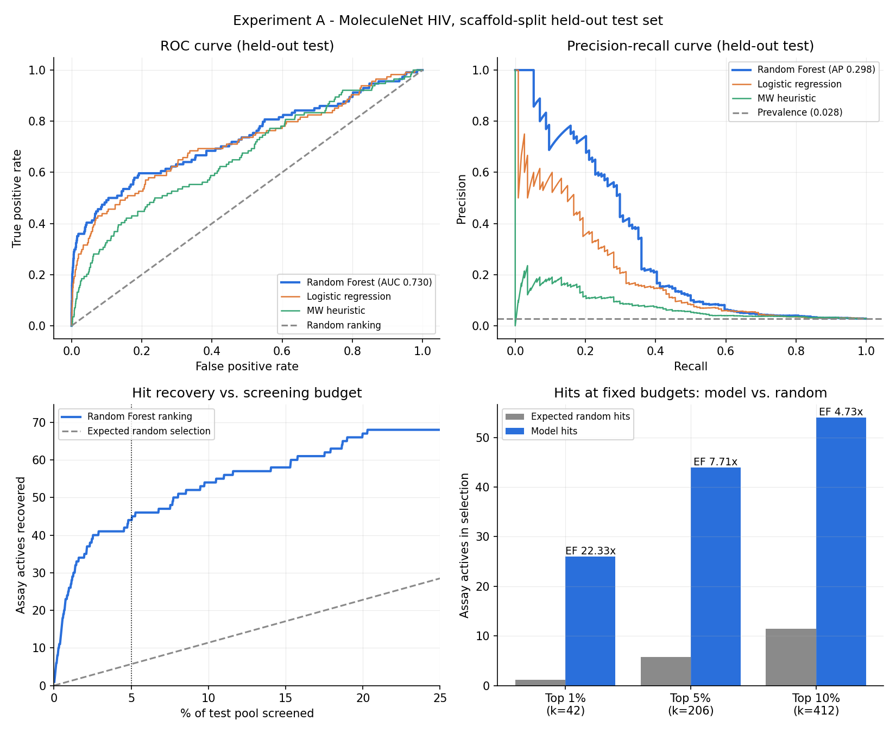
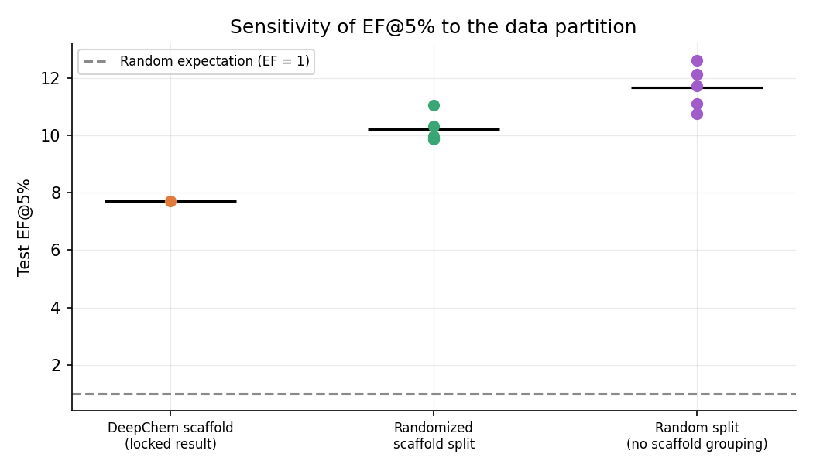

# AI for Drug Discovery: hit prioritization and molecular property prediction

Reproducible machine-learning pipeline on public MoleculeNet benchmarks, built with **RDKit**,
**DeepChem 2.8**, **scikit-learn** and **pandas**. Two connected experiments:

- **Experiment A** — rank molecules by predicted assay activity (MoleculeNet HIV, 41,127 compounds)
  and measure how many more actives a fixed screening budget recovers versus random selection.
- **Experiment B** — predict *measured* aqueous solubility (ESOL / Delaney, 1,116 compounds) as a
  continuous regression task on the same feature pipeline.

Everything reported here was produced by the scripts in `src/` on a scaffold-held-out test set that
was evaluated **once**, after model selection. See [REPORT.md](REPORT.md) for the full write-up and
[EXPERIMENT_LOG.md](EXPERIMENT_LOG.md) for the run record (versions, dataset hashes, decisions).

## Headline results

**Experiment A — hit prioritization.** Test pool 4,113 molecules, 114 actives (2.77%).

| Screening budget | Selected | Model hits | Expected at random | Enrichment | 95% CI |
|---|---:|---:|---:|---:|---:|
| Top 1% | 42 | 26 | 1.2 | **22.3x** | 16.7-28.2 |
| Top 5% | 206 | 44 | 5.7 | **7.71x** | 6.08-9.43 |
| Top 10% | 412 | 54 | 11.4 | **4.73x** | 3.87-5.63 |

ROC-AUC 0.730, average precision 0.298 (random ranking: 0.028). Hypergeometric p for the top 5%
result is about 3e-29.

**Honest comparison:** ranking by molecular weight alone already gives 4.03x and logistic regression
6.31x at the same budget. The Random Forest beats random selection by 7.7x, but beats a trivial size
heuristic by only about 1.9x.

**Experiment B — solubility.** Random Forest on fingerprints + RDKit descriptors: test MAE
**0.598**, RMSE 0.749, R-squared **0.810** in log10(mol/L), against MAE 1.496 for a mean-only
baseline. Fingerprints alone reach only R-squared 0.21 — nearly all the signal is in the ten
physicochemical descriptors.



**Does it depend on the split?** Re-evaluating the same model on other partitions (5 seeds each):
randomized scaffold splits give EF@5% 10.22 and plain random splits 11.67, against 7.71 for the
locked scaffold split. The reported result is the most conservative of the three — the gap measures
the leakage optimism that scaffold splitting removes.



**Where it works:** test average precision by nearest-neighbour Tanimoto similarity to the training
pool is 0.74 for 0.7-1.0, 0.39 for 0.5-0.7, and about 0.10-0.13 below 0.5. The model is strong on
chemistry resembling its training data and much weaker beyond it.

## What this is not

A retrospective ranking exercise on public benchmark labels. It does **not** demonstrate antiviral
potency, target binding, selectivity, toxicity or clinical efficacy, and no compound was tested in a
laboratory. Scores are rankings, not calibrated probabilities. The Lipinski flag in the screening
output is illustrative, not a developability assessment.

## Quickstart

Requires Python 3.10 (DeepChem 2.8.0 is most reliable there).

```bash
python -m venv .venv && .venv/Scripts/activate     # Windows; use source .venv/bin/activate elsewhere
python -m pip install -r requirements.txt
python -m pytest -q                                 # 23 unit tests, no network needed
```

Run the experiments from the repository root, in order. Datasets download automatically on first
use (about 2 MB).

```bash
python -m src.train                                  # Experiment A: clean, split, select, locked test
python -m src.solubility                             # Experiment B: ESOL regression
python -m src.screen --library data/sample_library.csv
python -m src.robustness                             # optional: split-sensitivity analysis
python -m src.analysis                               # optional: post-hoc error analysis
```

`src.train` takes roughly 9 minutes on 22 CPU cores; the rest take seconds to a couple of minutes.
Every script writes JSON metrics, CSV tables and figures under `outputs/`.

Any binary-labelled SMILES dataset works:

```bash
python -m src.train --csv data/my_assay.csv --smiles-column smiles --label-column active
```

## Method in brief

1. **Clean** — RDKit canonical isomeric SMILES; drop invalid, missing and non-binary records;
   deduplicate; exclude structures whose duplicate records disagree on the label.
2. **Split** — DeepChem `ScaffoldSplitter` (Bemis-Murcko) 80/10/10. Validation and test contain only
   singleton scaffolds and share no ring framework with training.
3. **Featurize** — 2,048-bit Morgan fingerprints, radius 2, chirality included; plus ten RDKit
   descriptors for Experiment B and for screening interpretation.
4. **Select** — three predeclared Random Forest configurations compared on *validation* average
   precision; logistic regression and a molecular-weight heuristic reported as comparators.
5. **Lock** — winner refitted on train + validation, evaluated exactly once on test, with
   hypergeometric p-values and bootstrap confidence intervals.
6. **Screen** — rank an external library, excluding invalid, duplicate and benchmark structures
   (including stereochemistry-free matches), and report descriptors and similarity to training.

## Repository layout

```text
src/chemistry.py     RDKit parsing, canonicalization, fingerprints, descriptors, scaffolds
src/data.py          download + provenance, auditing/cleaning, scaffold splits
src/metrics.py       ROC-AUC, average precision, enrichment, hypergeometric p, bootstrap
src/train.py         Experiment A end to end
src/solubility.py    Experiment B end to end
src/screen.py        rank an unlabelled library
src/robustness.py    split-sensitivity analysis (no re-tuning)
src/analysis.py      post-hoc error analysis of locked test predictions
src/plots.py         figures, generated only from evaluated results
tests/               unit tests for chemistry, metrics, cleaning, splitting, screening
docs/HANDBOOK.md     full method handbook
outputs/             committed results, metrics and figures
```

## Reproducibility

Seed 42 throughout; an identical rerun reproduced every validation and test metric exactly.
Dataset SHA256 hashes, package versions and hardware are recorded in `outputs/metrics.json` and
[EXPERIMENT_LOG.md](EXPERIMENT_LOG.md). Raw datasets and the model `.joblib` files are not
committed; both are regenerated by the commands above.

Note on loading models: `joblib.load` executes arbitrary code. Only load artifacts you produced.

## License

MIT — see [LICENSE](LICENSE). The datasets are public MoleculeNet benchmarks and remain under their
original terms.
