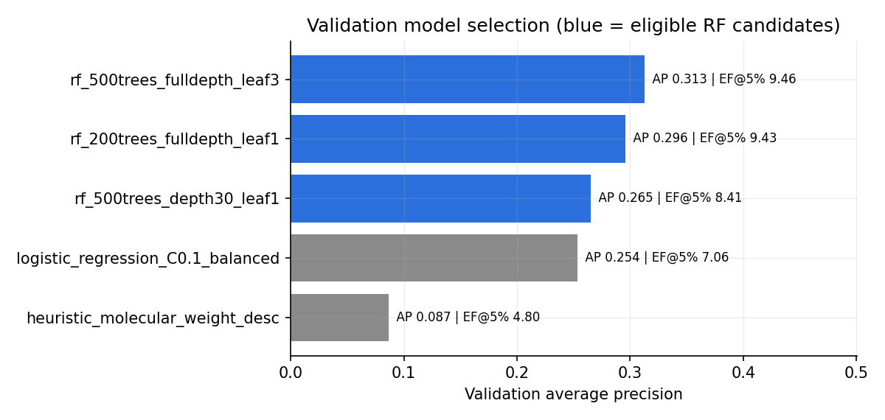
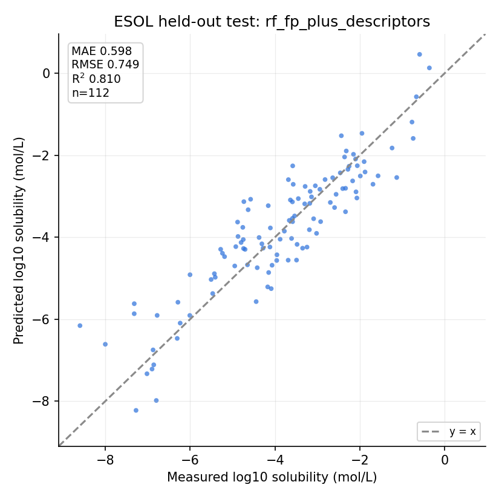
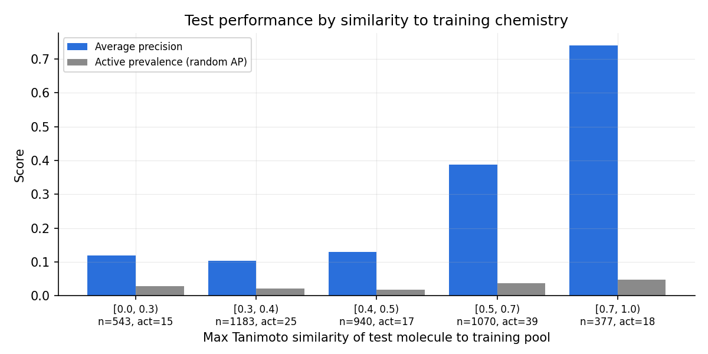

# Structure-based machine learning for retrospective hit prioritization and solubility prediction

Reproducible RDKit / DeepChem / scikit-learn study on public MoleculeNet benchmarks. Every number
below comes from files in `outputs/`, produced by the scripts in `src/`. The run record, including
package versions and dataset hashes, is in [EXPERIMENT_LOG.md](EXPERIMENT_LOG.md).

## Abstract

Early-stage screening tests far more molecules than any laboratory budget allows, so the order in
which compounds are tested matters. We asked whether a model trained only on molecular structure
can place more experimentally active molecules at the top of a ranked list than random selection,
and whether that advantage survives on chemotypes absent from training. Using the MoleculeNet HIV
dataset (41,127 compounds from the NCI antiviral screen, 3.5% labelled active), molecules were
represented as 2,048-bit Morgan fingerprints and partitioned with a Bemis-Murcko scaffold split
whose evaluation sets contain only singleton scaffolds. One of three predeclared Random Forest
configurations was selected on validation average precision and evaluated once on the held-out
test set. At a 5% screening budget it recovered 44 of 114 test actives in 206 picks against 5.7
expected at random: enrichment factor 7.7 (bootstrap 95% CI 6.1-9.4), ROC-AUC 0.730, average
precision 0.298. A molecular-weight heuristic already reached 4.0x and logistic regression 6.3x,
so the gain over a trivial ranking is smaller than the gain over random. Accuracy depended strongly
on similarity to training chemistry (average precision 0.74 for close analogues versus about 0.11
for dissimilar molecules). In a second experiment, measured aqueous solubility (ESOL, 1,116
compounds) was predicted with test MAE 0.60 log10(mol/L) and R-squared 0.81 by a Random Forest on
fingerprints plus RDKit descriptors, against MAE 1.50 for a mean-only baseline; fingerprints alone
performed poorly (R-squared at most 0.21). These are retrospective benchmark results. No compound
was tested in a laboratory.

## 1. Background

Primary screens typically return a few percent actives, so randomly ordered testing mostly fails.
A model that reorders a library so actives appear early lets a fixed budget find more of them. The
standard measure is the enrichment factor: hit rate among the top k ranked molecules divided by the
hit rate of the whole pool. Two cautions shape the design. Random train/test splits place close
analogues on both sides and inflate apparent performance, so a scaffold split is used as an
imperfect control. And benchmark activity labels come from a single assay: they do not establish
mechanism, potency or safety.

## 2. Data

| | HIV (Experiment A) | ESOL (Experiment B) | ClinTox (screening library) |
|---|---|---|---|
| Source | NCI DTP antiviral screen via MoleculeNet | Delaney 2004 via MoleculeNet | MoleculeNet ClinTox |
| Target | binary assay activity | measured log10 solubility (mol/L) | none used |
| Rows to cleaned | 41,127 to 41,127 | 1,128 to 1,116 | 1,484 to 1,360 novel |
| Cleaning notes | 0 invalid, 0 duplicates, 0 label conflicts | 10 duplicate rows averaged, 1 inconsistent structure dropped | invalid, polymer, duplicate and benchmark-overlap structures removed |

All three files were downloaded from DeepChem's public S3 bucket; URLs and SHA256 hashes are in
[data/README.md](data/README.md). All are public benchmark datasets containing no personal data.
The positive class merges the source's "confirmed active" and "confirmed moderately active"
categories, a documented simplification of the original three-class outcome.

## 3. Methods

**Cleaning.** SMILES were parsed and canonicalized with RDKit (isomeric). Missing, non-binary and
unparseable records were dropped, exact duplicate structures merged, and structures with
conflicting labels would have been excluded entirely (none occurred in the HIV data). Salts,
tautomers and charge states were deliberately not normalized; this is recorded as a limitation
rather than silently applied.

**Features.** Morgan fingerprints, radius 2, 2,048 bits, chirality included, via
`rdFingerprintGenerator.GetMorganGenerator`. Experiment B additionally used ten computed RDKit
descriptors: molecular weight, Crippen logP, topological polar surface area, H-bond donors and
acceptors, rotatable bonds, ring and aromatic-ring counts, heavy atoms and fraction sp3.

**Split.** DeepChem `ScaffoldSplitter`, 80/10/10. It assigns the largest scaffold families to
training, so the HIV validation and test sets (4,113 molecules each) consist entirely of singleton
scaffolds and share no non-empty scaffold with training.

**Models and selection.** Experiment A compared three predeclared `RandomForestClassifier`
configurations with balanced-subsample class weights, fitted through `dc.models.SklearnModel`, on
validation average precision. Experiment B compared a mean-only baseline, ridge regression at three
penalties, and Random Forests on fingerprints, on descriptors and on both, by validation MAE. The
winner of each experiment was refitted on train plus validation and evaluated once on test.
Logistic regression and a largest-molecular-weight-first heuristic were reported as comparators in
Experiment A but were not eligible for selection.

**Metrics.** ROC-AUC, average precision and enrichment at the top 1%, 5% and 10%, with ties at the
cut-off counted by their expectation so results do not depend on row order. Random selection was
modelled as hypergeometric sampling without replacement, giving both a p-value and the central 95%
range of hits a random selection would obtain. Uncertainty came from 2,000 bootstrap resamples of
the test molecules. Regression used MAE, RMSE and R-squared in log10(mol/L) with bootstrap
intervals; no target normalization was applied, so errors are in measured units.

**Post-hoc analyses, with no re-tuning.** Test performance by nearest-neighbour Tanimoto similarity
to the training pool; re-evaluation of the selected configuration on five randomized scaffold
splits and five random splits; a replication using the alternative candidate set from the original
starter code; and a breakdown of recovered hits by the source's two positive categories.

## 4. Results

### 4.1 Model selection, validation data only

| Candidate | Validation AP | Validation ROC-AUC | Validation EF@5% |
|---|---:|---:|---:|
| rf_200trees_fulldepth_leaf1 | 0.296 | 0.810 | 9.43 |
| **rf_500trees_fulldepth_leaf3 (selected)** | **0.313** | 0.805 | **9.46** |
| rf_500trees_depth30_leaf1 | 0.265 | 0.696 | 8.41 |
| logistic regression (comparator) | 0.254 | 0.738 | 7.06 |
| molecular-weight heuristic (comparator) | 0.087 | 0.669 | 4.80 |

No changes were made to the pipeline after seeing these numbers.

### 4.2 Locked test evaluation, Experiment A

Test pool: 4,113 molecules, 114 actives, prevalence 2.77%.

| Budget | Molecules selected | Model hits | Expected random hits (central 95% range) | Enrichment | Bootstrap 95% CI | Hypergeometric p |
|---|---:|---:|---:|---:|---:|---:|
| Top 1% | 42 | 26 | 1.16 (0-4) | **22.3x** | 16.7-28.2 | 2e-31 |
| Top 5% | 206 | 44 | 5.71 (2-11) | **7.71x** | 6.08-9.43 | 3e-29 |
| Top 10% | 412 | 54 | 11.42 (6-18) | **4.73x** | 3.87-5.63 | 2e-25 |

Overall ROC-AUC 0.730 and average precision 0.298, against 0.028 for a random ranking. Precision in
the top 5% was 21.4% and recall 38.6% of all test actives.

Comparators evaluated on the same test split and refitted the same way: logistic regression reached
average precision 0.196 and EF@5% 6.31; ranking by molecular weight alone reached 0.078 and 4.03.
The Random Forest therefore beats random selection by 7.7x but beats a trivial size ranking by only
about 1.9x, which is the more honest framing of the result.

An identical rerun with the same seed reproduced every validation and test metric exactly. A
replication using the three alternative Random Forest settings from the original starter code
selected a different configuration and reached test average precision 0.299, ROC-AUC 0.726 and
EF@5% 7.88, so the headline does not hinge on the particular hyperparameter grid.

### 4.3 Locked test evaluation, Experiment B

| Model | Features | Validation MAE | Test MAE | Test RMSE | Test R-squared |
|---|---|---:|---:|---:|---:|
| mean-only baseline | - | 1.824 | 1.496 | 1.933 | -0.265 |
| ridge, alpha 10 | fingerprint | 1.251 | 1.269 | 1.614 | 0.118 |
| random forest | fingerprint | 1.323 | 1.160 | 1.530 | 0.208 |
| random forest | descriptors | 0.742 | 0.644 | 0.809 | 0.778 |
| **random forest (selected)** | fingerprint + descriptors | **0.721** | **0.598** | **0.749** | **0.810** |

Bootstrap 95% intervals for the selected model: MAE 0.517-0.683, RMSE 0.654-0.850, R-squared
0.746-0.854. The MAE improvement over the mean baseline is 0.90 log units (95% CI 0.68-1.12).
The contrast between rows matters more than the headline: the same fingerprints that rank activity
well carry little solubility signal on their own, and almost all of the accuracy comes from the ten
physicochemical descriptors. Fingerprints add a small further gain.

### 4.4 Where the model works and where it does not

| Max Tanimoto to training pool | Test molecules | Actives | Average precision | EF@5% |
|---|---:|---:|---:|---:|
| 0.0-0.3 | 543 | 15 | 0.119 | 5.17 |
| 0.3-0.4 | 1,183 | 25 | 0.103 | 3.15 |
| 0.4-0.5 | 940 | 17 | 0.129 | 3.53 |
| 0.5-0.7 | 1,070 | 39 | 0.388 | 9.65 |
| 0.7-1.0 | 377 | 18 | 0.740 | 14.33 |

Scaffold splitting removes shared ring frameworks but not chemical similarity: 377 test molecules
still have a training neighbour at Tanimoto 0.7 or above, and that is where the model is strongest.
For the 2,666 molecules below 0.5 similarity, average precision falls to roughly 0.10-0.13, still
several times prevalence but far below the headline figure. Recovered hits are concentrated in the
source's stronger activity category (68% of confirmed actives recovered in the top 5%, against 30%
of moderately active compounds), which is the desirable direction.

The 162 false positives in the top 5% are not random errors. They are dominated by a few chemical
families that are rich in actives in the training data, and the selected set is systematically
larger than the rest of the pool (median molecular weight 562 against 362). That echoes the
molecular-weight comparator: part of what the model has learned is a size and composition signal
characteristic of this assay rather than a target-specific one.

### 4.5 Does the result depend on the partition?

The selected configuration was re-evaluated, without any re-tuning, on alternative partitions of the
same cleaned dataset, five seeds each.

| Partition | ROC-AUC | Average precision | EF@5% (mean, range) |
|---|---:|---:|---:|
| DeepChem scaffold split (locked result) | 0.730 | 0.298 | **7.71** |
| Randomized scaffold split, 5 seeds | 0.812 | 0.377 | 10.22 (9.85-11.05) |
| Random split, no scaffold grouping, 5 seeds | 0.855 | 0.460 | 11.67 (10.75-12.63) |

Two things follow. Enrichment is far above 1 under every partition, so the headline conclusion is not
an artifact of one split. And the locked result is the most conservative of the three: a plain random
split, which scatters close analogues across training and test, would have reported EF@5% around 11.7
and ROC-AUC 0.855. The gap between those rows is a direct measurement of the optimism that scaffold
splitting removes, and it is the reason the lower number is the one reported in the abstract.

### 4.6 Case study: ranking an external library

The trained model was applied to MoleculeNet ClinTox as a stand-in for an unlabelled vendor
catalogue; its own labels were ignored. Of 1,484 rows, 4 were unparseable, 1 was a polymer entry
with dummy atoms, 19 were duplicate structures and 100 were already in the HIV benchmark, leaving
1,360 ranked molecules.

The benchmark-overlap filter is worth describing, because the first version of it failed. Matching
on exact isomeric SMILES left a known antiretroviral at rank 1 even though the same structure is in
the training set recorded without stereochemistry. The filter now also compares stereochemistry-free
canonical SMILES, which removed 40 further molecules. The naive version would have produced a
"novel top hit" that the model had simply memorized. A structure that is in the training data cannot
be evidence about new chemistry, whatever score it receives.

After the fix, the top of the ranking is chemically coherent: nucleoside analogues, several kinase
inhibitors, and one approved antiretroviral that genuinely was not in the benchmark. The top ten
spans eight distinct scaffolds and has a median similarity to training chemistry of 0.41, slightly
above the library median of 0.35. A greedy diversity filter (Tanimoto below 0.6 between picks) marks
a spread-out shortlist in the exported file. These are prioritized candidates, not hits: nothing
here has been tested, and a high score for a molecule unlike the training data falls in exactly the
similarity range where section 4.4 shows the model is weakest.

## 5. Discussion

The primary question has a clear answer on this benchmark. At a fixed 5% budget the model found 44
actives where random ordering would be expected to find about 6, and the probability of that result
under random selection is vanishingly small. The effect is not an artifact of one partition: across
randomized scaffold splits and random splits the enrichment stays in the same broad range, with
random splits optimistic relative to scaffold splits, as expected.

Three qualifications matter more than the headline.

First, the comparison baseline changes the story. Random selection is the right null for a
screening-budget argument, but it is a weak competitor. Against a one-line molecular-weight
heuristic the model's advantage shrinks to roughly 1.9x, and against logistic regression on the same
features to about 1.2x. Reporting only the 7.7x figure would overstate what the learned
representation contributes.

Second, generalization is uneven. The model is reliable for molecules resembling its training set
and much weaker beyond it, which is precisely the regime a prospective screen operates in. Scaffold
splitting mitigates but does not eliminate this; an applicability-domain flag based on
nearest-neighbour similarity would be a practical addition before any real use.

Third, the labels are what they are: outcomes from one historical cell-based screen, with two
positive categories merged. Compounds can score active there for reasons unrelated to a specific
antiviral mechanism, and the false-positive analysis suggests the model has partly learned the
physicochemical profile of that assay's actives.

The solubility experiment is a useful counterweight. It shows the same pipeline handling a
continuous, physically measured property, and it shows that the representation that works well for
one task is not automatically right for another: substructure fingerprints alone explain little of
the solubility variance, while ten cheap descriptors explain most of it.

## 6. Limitations

- Retrospective benchmark only. No compound was synthesized, procured or assayed, and no enrichment
  figure here translates into a measured laboratory hit rate or cost saving.
- One dataset, one assay, one deterministic primary split. The sensitivity analysis varies the
  partition but not the data source.
- No salt, tautomer or protonation standardization, and no handling of mixtures.
- Random Forest scores are rankings, not calibrated probabilities; no calibration was performed.
- Computed descriptors such as logP are calculations, not measurements, and the Lipinski flag in the
  screening output is an illustrative filter, not a developability or safety assessment.
- The graph-neural-network comparison described in the handbook was not run; it would require
  additional dependencies and should be evaluated on these exact splits before any claim is made.

## 7. Conclusions and next steps

Structure-based machine learning substantially outperformed random selection at prioritizing
assay-active molecules on a scaffold-held-out benchmark, and the same feature pipeline predicted a
measured physical property to within 0.6 log units. The advantage is real but conditional: it is
largest for chemistry resembling the training set and modest relative to simple baselines.

Useful next steps, in order of value: add an applicability-domain flag and report enrichment
separately inside and outside it; repeat the whole protocol on a second, independent assay to test
transfer; benchmark a graph neural network on these exact splits; calibrate scores on a held-apart
subset if probabilities are ever needed. Biological validation would require a partner laboratory:
a diversity-filtered shortlist of top-ranked, benchmark-novel compounds alongside matched
low-scoring controls, tested with dose-response and a cytotoxicity counter-screen, comparing the
observed hit rate between the two groups.

## Appendix

- Software: Python 3.10.22, RDKit 2024.03.5, DeepChem 2.8.0, scikit-learn 1.5.2, NumPy 1.26.4,
  pandas 2.2.3, SciPy 1.13.1. Seed 42 throughout. Hardware: 22-core x86-64 CPU, no GPU.
  HIV training run time about 9 minutes; solubility about 30 seconds.
- Dataset URLs and SHA256 hashes: [data/README.md](data/README.md).
- Full run record and decisions: [EXPERIMENT_LOG.md](EXPERIMENT_LOG.md).
- Method handbook: [docs/HANDBOOK.md](docs/HANDBOOK.md).
- Result files: `outputs/metrics.json`, `outputs/solubility_metrics.json`,
  `outputs/error_analysis.json`, `outputs/robustness.json`, `outputs/screened_clintox.csv`.

## References

1. Wu et al. MoleculeNet: a benchmark for molecular machine learning. *Chemical Science* 9, 513 (2018).
2. Delaney. ESOL: estimating aqueous solubility directly from molecular structure. *J. Chem. Inf. Comput. Sci.* 44, 1000 (2004).
3. Bemis and Murcko. The properties of known drugs. 1. Molecular frameworks. *J. Med. Chem.* 39, 2887 (1996).
4. Rogers and Hahn. Extended-connectivity fingerprints. *J. Chem. Inf. Model.* 50, 742 (2010).
5. RDKit: open-source cheminformatics. https://www.rdkit.org
6. DeepChem documentation. https://deepchem.readthedocs.io/en/2.8.0/
